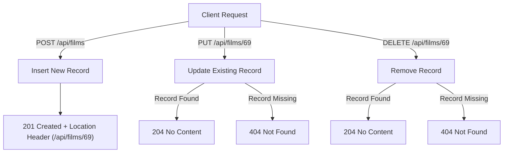

# Step 04: Modifying Data (POST, PUT, DELETE)

[⬅️ Step 03: Reading Data](03-reading-data-get-endpoints.md) &bull; **Step 04: Modifying Data (POST, PUT, DELETE)** &bull; [Next: Step 05 ➡️](05-structuring-endpoints-and-route-groups.md)

---

In this step, you will implement the full write cycle of **CRUD** (Create, Read, Update, Delete) operations. You will build endpoints for adding new films (`POST`), updating existing film details (`PUT`), and removing films (`DELETE`), while adhering to REST conventions, validating input, and respecting SQLite CHECK constraints.

---

## 1. RESTful Mutation Conventions & HTTP Status Codes

When modifying data on a server, RESTful APIs communicate outcome through standard HTTP status codes:



| HTTP Method | Route | Purpose | Success Status | Missing / Error Status |
| :--- | :--- | :--- | :--- | :--- |
| `POST` | `/api/films` | Insert a new film record | `201 Created` | `400 Bad Request` |
| `PUT` | `/api/films/{id}` | Replace/Update an existing film | `204 No Content` | `404 Not Found` or `400 Bad Request` |
| `DELETE` | `/api/films/{id}` | Remove a film by ID | `204 No Content` | `404 Not Found` |

---

## 2. Endpoint 4: POST (Creating a Film)

When a client sends a `POST` request with a JSON body, ASP.NET Core deserializes the JSON payload directly into a C# `Film` object.

```csharp
app.MapPost("/api/films", async Task<Results<Created<Film>, BadRequest<string>>> (
    Film film,
    FilmContext db) =>
{
    // 1. Validation against SQLite constraints
    if (string.IsNullOrWhiteSpace(film.FilmTitle) || film.FilmTitle.Length > 70)
    {
        return TypedResults.BadRequest("Film title is required and cannot exceed 70 characters.");
    }

    if (string.IsNullOrWhiteSpace(film.FilmCertificate) || film.FilmCertificate.Length > 5)
    {
        return TypedResults.BadRequest("Certificate is required and cannot exceed 5 characters.");
    }

    if (film.FilmPrice < 0)
    {
        return TypedResults.BadRequest("Price must be greater than or equal to 0.");
    }

    if (film.Stars < 1 || film.Stars > 5)
    {
        return TypedResults.BadRequest("Stars rating must be between 1 and 5.");
    }

    // 2. Ensure ID is 0 so SQLite assigns an AUTOINCREMENT primary key
    film.FilmId = 0;

    // 3. Stage the entity and commit to SQLite
    db.Films.Add(film);
    await db.SaveChangesAsync();

    // 4. Return 201 Created with Location header pointing to the new resource
    return TypedResults.Created($"/api/films/{film.FilmId}", film);
});
```

### Important Details:
- **`film.FilmId = 0;`**: In SQLite, an `INTEGER PRIMARY KEY AUTOINCREMENT` column generates a new ID only when passed `0` or `NULL`. Setting `FilmId = 0` guarantees that even if a client sends an `id` property in their JSON payload, the database assigns a genuine new ID.
- **`TypedResults.Created(uri, entity)`**: Returns an HTTP `201 Created` status code with the newly generated object in the response body, and automatically attaches a `Location` response header (e.g. `Location: /api/films/69`).

---

## 3. Endpoint 5: PUT (Updating a Film)

The `PUT` verb represents a complete replacement of a resource at a given URL (`/api/films/{id}`):

```csharp
app.MapPut("/api/films/{id:int}", async Task<Results<NoContent, NotFound, BadRequest<string>>> (
    int id,
    Film updatedFilm,
    FilmContext db) =>
{
    // 1. Find existing record in SQLite
    var film = await db.Films.FindAsync(id);
    if (film is null)
    {
        return TypedResults.NotFound();
    }

    // 2. Validate input
    if (string.IsNullOrWhiteSpace(updatedFilm.FilmTitle) || updatedFilm.FilmTitle.Length > 70)
    {
        return TypedResults.BadRequest("Title is required and must not exceed 70 characters.");
    }

    if (updatedFilm.FilmPrice < 0)
    {
        return TypedResults.BadRequest("Price must be greater than or equal to 0.");
    }

    // 3. Update entity fields
    film.FilmTitle = updatedFilm.FilmTitle;
    film.FilmCertificate = updatedFilm.FilmCertificate;
    film.FilmDescription = updatedFilm.FilmDescription;
    film.FilmImage = updatedFilm.FilmImage;
    film.FilmPrice = updatedFilm.FilmPrice;
    film.Stars = updatedFilm.Stars;
    film.ReleaseDate = updatedFilm.ReleaseDate;

    // 4. Save changes to SQLite
    await db.SaveChangesAsync();

    // 5. Return 204 No Content
    return TypedResults.NoContent();
});
```

### Why Update Properties Individually?
Updating properties on the tracked entity retrieved via `FindAsync(id)`:
1. Prevents **over-posting** vulnerabilities (e.g., preventing a client from modifying the immutable primary key `filmID`).
2. EF Core's Change Tracker detects exactly which properties changed and generates a minimal `UPDATE Films SET filmTitle = ... WHERE filmID = ...` SQL statement.

---

## 4. Endpoint 6: DELETE (Removing a Film)

The `DELETE` verb removes an existing record:

```csharp
app.MapDelete("/api/films/{id:int}", async Task<Results<NoContent, NotFound>> (
    int id,
    FilmContext db) =>
{
    var film = await db.Films.FindAsync(id);
    if (film is null)
    {
        return TypedResults.NotFound();
    }

    db.Films.Remove(film);
    await db.SaveChangesAsync();

    return TypedResults.NoContent();
});
```

---

## 5. Complete `Program.cs` with Full CRUD

Here is your updated `Program.cs` containing all 5 REST operations:

```csharp
using Microsoft.AspNetCore.Http.HttpResults;
using Microsoft.EntityFrameworkCore;
using FilmApi.Data;
using FilmApi.Models;

var builder = WebApplication.CreateBuilder(args);

// Register SQLite FilmContext
builder.Services.AddSqlite<FilmContext>(
    builder.Configuration.GetConnectionString("DefaultConnection")
);

// Register OpenAPI
builder.Services.AddOpenApi();

var app = builder.Build();

if (app.Environment.IsDevelopment())
{
    app.MapOpenApi();
}

app.UseHttpsRedirection();

// -------------------------------------------------------------
// GET Endpoints
// -------------------------------------------------------------
app.MapGet("/api/films", async (
    string? title,
    int? minStars,
    string? certificate,
    FilmContext db) =>
{
    var query = db.Films.AsQueryable();

    if (!string.IsNullOrWhiteSpace(title))
    {
        query = query.Where(f => EF.Functions.Like(f.FilmTitle, $"%{title}%"));
    }

    if (minStars.HasValue)
    {
        query = query.Where(f => f.Stars >= minStars.Value);
    }

    if (!string.IsNullOrWhiteSpace(certificate))
    {
        query = query.Where(f => f.FilmCertificate == certificate);
    }

    return TypedResults.Ok(await query.ToListAsync());
});

app.MapGet("/api/films/{id:int}", async Task<Results<Ok<Film>, NotFound>> (int id, FilmContext db) =>
{
    var film = await db.Films.FindAsync(id);
    return film is not null ? TypedResults.Ok(film) : TypedResults.NotFound();
});

// -------------------------------------------------------------
// POST Endpoint (Create)
// -------------------------------------------------------------
app.MapPost("/api/films", async Task<Results<Created<Film>, BadRequest<string>>> (Film film, FilmContext db) =>
{
    if (string.IsNullOrWhiteSpace(film.FilmTitle) || film.FilmTitle.Length > 70)
        return TypedResults.BadRequest("Title is required and cannot exceed 70 characters.");

    if (string.IsNullOrWhiteSpace(film.FilmCertificate) || film.FilmCertificate.Length > 5)
        return TypedResults.BadRequest("Certificate is required and cannot exceed 5 characters.");

    if (film.FilmPrice < 0)
        return TypedResults.BadRequest("Price must be non-negative.");

    if (film.Stars < 1 || film.Stars > 5)
        return TypedResults.BadRequest("Stars must be between 1 and 5.");

    film.FilmId = 0;
    db.Films.Add(film);
    await db.SaveChangesAsync();

    return TypedResults.Created($"/api/films/{film.FilmId}", film);
});

// -------------------------------------------------------------
// PUT Endpoint (Update)
// -------------------------------------------------------------
app.MapPut("/api/films/{id:int}", async Task<Results<NoContent, NotFound, BadRequest<string>>> (
    int id,
    Film inputFilm,
    FilmContext db) =>
{
    var film = await db.Films.FindAsync(id);
    if (film is null) return TypedResults.NotFound();

    if (string.IsNullOrWhiteSpace(inputFilm.FilmTitle) || inputFilm.FilmTitle.Length > 70)
        return TypedResults.BadRequest("Title cannot exceed 70 characters.");

    if (inputFilm.FilmPrice < 0)
        return TypedResults.BadRequest("Price must be non-negative.");

    film.FilmTitle = inputFilm.FilmTitle;
    film.FilmCertificate = inputFilm.FilmCertificate;
    film.FilmDescription = inputFilm.FilmDescription;
    film.FilmImage = inputFilm.FilmImage;
    film.FilmPrice = inputFilm.FilmPrice;
    film.Stars = inputFilm.Stars;
    film.ReleaseDate = inputFilm.ReleaseDate;

    await db.SaveChangesAsync();
    return TypedResults.NoContent();
});

// -------------------------------------------------------------
// DELETE Endpoint (Remove)
// -------------------------------------------------------------
app.MapDelete("/api/films/{id:int}", async Task<Results<NoContent, NotFound>> (int id, FilmContext db) =>
{
    var film = await db.Films.FindAsync(id);
    if (film is null) return TypedResults.NotFound();

    db.Films.Remove(film);
    await db.SaveChangesAsync();

    return TypedResults.NoContent();
});

app.Run();
```

---

## 6. Testing Mutations via Terminal (`curl`)

Start the application with `dotnet run` and test with `curl` in a separate terminal:

### Test 1: Insert a Film (POST)
```bash
curl -i -X POST http://localhost:5000/api/films \
  -H "Content-Type: application/json" \
  -d '{
    "filmTitle": "Inception",
    "filmCertificate": "12A",
    "filmDescription": "A thief who steals corporate secrets through dream-sharing technology.",
    "filmImage": "inception.jpg",
    "filmPrice": 3.99,
    "stars": 5,
    "releaseDate": "2010-07-16"
  }'
```

Notice the response headers:
```text
HTTP/1.1 201 Created
Location: /api/films/69
Content-Type: application/json; charset=utf-8
```

### Test 2: Update the Film (PUT)
```bash
curl -i -X PUT http://localhost:5000/api/films/69 \
  -H "Content-Type: application/json" \
  -d '{
    "filmTitle": "Inception (Special Edition)",
    "filmCertificate": "12A",
    "filmDescription": "Special anniversary edition with director commentary.",
    "filmImage": "inception_special.jpg",
    "filmPrice": 4.99,
    "stars": 5,
    "releaseDate": "2010-07-16"
  }'
```

Response:
```text
HTTP/1.1 204 No Content
```

### Test 3: Delete the Film (DELETE)
```bash
curl -i -X DELETE http://localhost:5000/api/films/69
```

Response:
```text
HTTP/1.1 204 No Content
```

### Test 4: Confirm Deletion
```bash
curl -i http://localhost:5000/api/films/69
```

Response:
```text
HTTP/1.1 404 Not Found
```

---

## Summary

In this step, you:
- Implemented `POST` to insert new records and return `201 Created` with a `Location` header.
- Implemented `PUT` to update existing entities safely while preventing over-posting.
- Implemented `DELETE` to remove records and return `204 No Content`.
- Validated inputs against SQLite database CHECK constraints.

---

[⬅️ Step 03: Reading Data](03-reading-data-get-endpoints.md) &bull; **Step 04: Modifying Data (POST, PUT, DELETE)** &bull; [Next: Step 05 - Structuring Endpoints and Route Groups ➡️](05-structuring-endpoints-and-route-groups.md)
