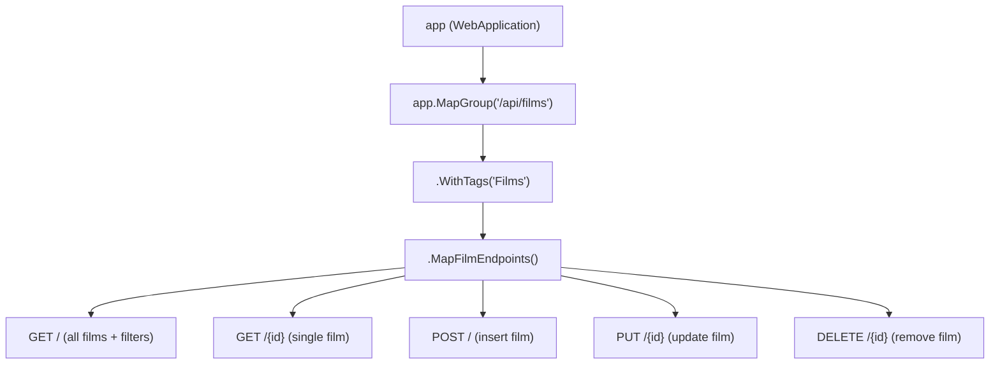

# Step 05: Structuring Endpoints and Route Groups

[⬅️ Step 04: Modifying Data](04-modifying-data-post-put-delete.md) &bull; **Step 05: Structuring Endpoints & Route Groups** &bull; [Next: Step 06 ➡️](06-testing-with-http-files-and-openapi.md)

---

As an API expands to include multiple resources (e.g., films, actors, genres, reviews), keeping all endpoint lambdas inside `Program.cs` leads to a bloated, unmaintainable "god file".

In this step, you will learn how to refactor your endpoints into a dedicated module using **Route Groups** (`MapGroup`) and **C# Extension Methods**, while enriching endpoints with OpenAPI documentation metadata.

---

## 1. What are Route Groups?

Introduced in .NET 7 and optimized in .NET 10, `app.MapGroup(...)` allows you to:
1. **Eliminate URL duplication**: Define `/api/films` once as a prefix rather than repeating it on every single endpoint.
2. **Apply common policies**: Apply authorization, CORS, rate limiting, or OpenAPI tags to all endpoints in the group simultaneously.
3. **Organize handlers**: Delegate endpoint definitions to separate classes using extension methods.



---

## 2. Create `Endpoints/FilmEndpoints.cs`

1. Create an `Endpoints` directory:
   ```bash
   mkdir -p Endpoints
   ```
2. Create `Endpoints/FilmEndpoints.cs` and paste the following code:

```csharp
using Microsoft.AspNetCore.Http.HttpResults;
using Microsoft.EntityFrameworkCore;
using FilmApi.Data;
using FilmApi.Models;

namespace FilmApi.Endpoints;

public static class FilmEndpoints
{
    public static RouteGroupBuilder MapFilmEndpoints(this RouteGroupBuilder group)
    {
        group.MapGet("/", GetAllFilms)
            .WithName("GetAllFilms")
            .WithSummary("Retrieve all films with optional filtering");

        group.MapGet("/{id:int}", GetFilmById)
            .WithName("GetFilmById")
            .WithSummary("Retrieve a single film by its database ID");

        group.MapPost("/", CreateFilm)
            .WithName("CreateFilm")
            .WithSummary("Add a new film to the catalogue");

        group.MapPut("/{id:int}", UpdateFilm)
            .WithName("UpdateFilm")
            .WithSummary("Update an existing film by ID");

        group.MapDelete("/{id:int}", DeleteFilm)
            .WithName("DeleteFilm")
            .WithSummary("Remove a film from the catalogue");

        return group;
    }

    // -----------------------------------------------------------------
    // Handler Methods
    // -----------------------------------------------------------------

    public static async Task<Ok<List<Film>>> GetAllFilms(
        string? title,
        int? minStars,
        string? certificate,
        FilmContext db)
    {
        var query = db.Films.AsQueryable();

        if (!string.IsNullOrWhiteSpace(title))
        {
            query = query.Where(f => EF.Functions.Like(f.FilmTitle, $"%{title}%"));
        }

        if (minStars.HasValue)
        {
            query = query.Where(f => f.Stars >= minStars.Value);
        }

        if (!string.IsNullOrWhiteSpace(certificate))
        {
            query = query.Where(f => f.FilmCertificate == certificate);
        }

        return TypedResults.Ok(await query.ToListAsync());
    }

    public static async Task<Results<Ok<Film>, NotFound>> GetFilmById(int id, FilmContext db)
    {
        var film = await db.Films.FindAsync(id);
        return film is not null ? TypedResults.Ok(film) : TypedResults.NotFound();
    }

    public static async Task<Results<Created<Film>, BadRequest<string>>> CreateFilm(
        Film film,
        FilmContext db)
    {
        if (string.IsNullOrWhiteSpace(film.FilmTitle) || film.FilmTitle.Length > 70)
            return TypedResults.BadRequest("Title is required and cannot exceed 70 characters.");

        if (string.IsNullOrWhiteSpace(film.FilmCertificate) || film.FilmCertificate.Length > 5)
            return TypedResults.BadRequest("Certificate is required and cannot exceed 5 characters.");

        if (film.FilmPrice < 0)
            return TypedResults.BadRequest("Price must be non-negative.");

        if (film.Stars < 1 || film.Stars > 5)
            return TypedResults.BadRequest("Stars must be between 1 and 5.");

        film.FilmId = 0;
        db.Films.Add(film);
        await db.SaveChangesAsync();

        return TypedResults.Created($"/api/films/{film.FilmId}", film);
    }

    public static async Task<Results<NoContent, NotFound, BadRequest<string>>> UpdateFilm(
        int id,
        Film updatedFilm,
        FilmContext db)
    {
        var film = await db.Films.FindAsync(id);
        if (film is null) return TypedResults.NotFound();

        if (string.IsNullOrWhiteSpace(updatedFilm.FilmTitle) || updatedFilm.FilmTitle.Length > 70)
            return TypedResults.BadRequest("Title cannot exceed 70 characters.");

        if (updatedFilm.FilmPrice < 0)
            return TypedResults.BadRequest("Price must be non-negative.");

        film.FilmTitle = updatedFilm.FilmTitle;
        film.FilmCertificate = updatedFilm.FilmCertificate;
        film.FilmDescription = updatedFilm.FilmDescription;
        film.FilmImage = updatedFilm.FilmImage;
        film.FilmPrice = updatedFilm.FilmPrice;
        film.Stars = updatedFilm.Stars;
        film.ReleaseDate = updatedFilm.ReleaseDate;

        await db.SaveChangesAsync();
        return TypedResults.NoContent();
    }

    public static async Task<Results<NoContent, NotFound>> DeleteFilm(int id, FilmContext db)
    {
        var film = await db.Films.FindAsync(id);
        if (film is null) return TypedResults.NotFound();

        db.Films.Remove(film);
        await db.SaveChangesAsync();

        return TypedResults.NoContent();
    }
}
```

---

## 3. The Clean `Program.cs`

Now look at how clean and readable `Program.cs` becomes! Replace `Program.cs` with:

```csharp
using FilmApi.Data;
using FilmApi.Endpoints;

var builder = WebApplication.CreateBuilder(args);

// Register SQLite FilmContext
builder.Services.AddSqlite<FilmContext>(
    builder.Configuration.GetConnectionString("DefaultConnection")
);

// Register OpenAPI documentation
builder.Services.AddOpenApi();

var app = builder.Build();

if (app.Environment.IsDevelopment())
{
    app.MapOpenApi();
}

app.UseHttpsRedirection();

// Map the Films Route Group with OpenAPI Tags
app.MapGroup("/api/films")
   .MapFilmEndpoints()
   .WithTags("Films");

app.Run();
```

---

## 4. Understanding the Architectural Benefits

1. **Separation of Concerns**: `Program.cs` handles app startup, middleware configuration, and service registrations. Route endpoints and business logic reside in `Endpoints/`.
2. **Scalability**: If you later add `Actors`, `Directors`, or `Reviews`, you simply create `ActorEndpoints.cs` and add `app.MapGroup("/api/actors").MapActorEndpoints();`.
3. **OpenAPI Enrichment**:
   - `.WithName(...)`: Gives a unique programmatic identifier to each operation.
   - `.WithSummary(...)`: Provides a concise summary displayed in interactive API viewers.
   - `.WithTags("Films")`: Groups related operations together in API documentation.

---

## Summary

In this step, you:
- Created a separate `FilmEndpoints` class using the C# extension method pattern on `RouteGroupBuilder`.
- Separated HTTP route mappings from endpoint handler methods.
- Refactored `Program.cs` into a clean, minimal startup script.
- Added OpenAPI documentation metadata (`WithName`, `WithSummary`, `WithTags`).

---

[⬅️ Step 04: Modifying Data](04-modifying-data-post-put-delete.md) &bull; **Step 05: Structuring Endpoints & Route Groups** &bull; [Next: Step 06 - Testing with .http Files and OpenAPI ➡️](06-testing-with-http-files-and-openapi.md)
