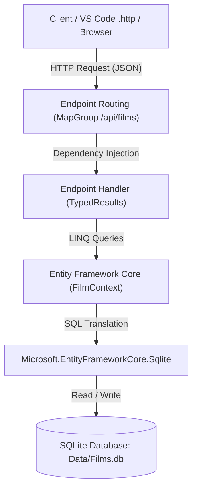

# Building a Minimal API with .NET 10, EF Core, and SQLite

Welcome to this step-by-step tutorial on building a production-ready **RESTful Minimal API** in **.NET 10** using **Visual Studio Code**, **Entity Framework Core**, and an existing **SQLite** database (`Data/Films.db`).

---

## 🎯 What You Will Learn

By following this guide, you will learn how to:

- Create and configure an ASP.NET Core Minimal API project from the command line using the .NET 10 CLI.
- Connect an existing SQLite database to your application using **Entity Framework Core (EF Core)**.
- Reverse-engineer and map a C# entity model to an existing database table with schema constraints (primary keys, check constraints, character lengths).
- Implement asynchronous HTTP endpoints for **CRUD** (Create, Read, Update, Delete) operations using modern .NET 10 patterns (`TypedResults`).
- Handle query parameters for filtering and searching datasets.
- Organize and refactor endpoints using **Route Groups** (`MapGroup`) and extension methods.
- Test and document endpoints directly within VS Code using `.http` files and OpenAPI / Scalar documentation.

---

## 🏗️ Architecture Overview

The application follows a clean, lightweight architecture using .NET Minimal APIs:



### Why Minimal APIs?

Introduced in .NET 6 and continuously refined through .NET 10, **Minimal APIs** offer a streamlined approach to building HTTP services:

| Traditional Controller-Based APIs | Minimal APIs (.NET 10) |
| :--- | :--- |
| Heavy ceremony: controllers, attributes, action methods | Lean lambdas and route endpoints mapped directly to the app |
| Slower startup due to reflection and controller scanning | Faster cold start and reduced memory footprint |
| Scattered routing across multiple class files | Centralized or modular route definitions (`MapGroup`) |
| Often overkill for microservices, SPA backends, and small APIs | Ideal for microservices, rapid prototyping, and clean architectures |

---

## 🗄️ Database Context: The `Films` Table

This tutorial uses the SQLite database located at [Data/Films.db](Data/Films.db). The database contains a `Films` table created with the following schema:

```sql
CREATE TABLE Films (
    filmID INTEGER PRIMARY KEY AUTOINCREMENT,
    filmTitle TEXT NOT NULL CHECK(length(filmTitle) <= 70),
    filmCertificate TEXT NOT NULL CHECK(length(filmCertificate) <= 5),
    filmDescription TEXT NOT NULL,
    filmImage TEXT NOT NULL CHECK(length(filmImage) <= 50),
    filmPrice NUMERIC NOT NULL CHECK(filmPrice >= 0),
    stars INTEGER NOT NULL,
    releaseDate TEXT NOT NULL CHECK(releaseDate GLOB '[0-9][0-9][0-9][0-9]-[0-9][0-9]-[0-9][0-9]')
);
CREATE INDEX idx_films_title ON Films(filmTitle);
CREATE INDEX idx_films_release_date ON Films(releaseDate);
```

### Table Schema Summary

| Column Name | SQLite Data Type | C# Property Type | Constraints / Rules |
| :--- | :--- | :--- | :--- |
| `filmID` | `INTEGER` | `int FilmId` | Primary Key, Auto-increment |
| `filmTitle` | `TEXT` | `string FilmTitle` | Required, Max Length: 70 |
| `filmCertificate` | `TEXT` | `string FilmCertificate` | Required, Max Length: 5 (`U`, `PG`, `12`, `12A`, `15`, `18`) |
| `filmDescription` | `TEXT` | `string FilmDescription` | Required, Unbounded text |
| `filmImage` | `TEXT` | `string FilmImage` | Required, Max Length: 50 (e.g. `cinemaParadiso.jpg`) |
| `filmPrice` | `NUMERIC` | `decimal FilmPrice` | Required, Must be >= 0.00 |
| `stars` | `INTEGER` | `int Stars` | Required, Star rating (1 to 5) |
| `releaseDate` | `TEXT` | `DateOnly ReleaseDate` | Required, Format `YYYY-MM-DD` |

---

## 📋 Prerequisites

Before starting, ensure you have the following installed:

1. **.NET 10 SDK**: Verify by running `dotnet --version` in your terminal. You should see `10.x.x`.
2. **Visual Studio Code**: With the recommended extensions:
   - **C# Dev Kit** (or **C#** extension by Microsoft).
   - **REST Client** (by Huachao Mao) or built-in .NET `.http` file support.
   - **SQLite Viewer** (optional, for inspecting `Data/Films.db` within VS Code).

---

## 🗺️ Tutorial Steps

Follow each step in sequence:

| Step | Title | Description |
| :--- | :--- | :--- |
| **01** | [Project Setup & CLI](01-project-setup.md) | Initialize a .NET 10 Web API project, add EF Core SQLite packages, and test the default server. |
| **02** | [Database Model & DbContext](02-database-model-and-context.md) | Map C# classes to the SQLite table, configure `FilmContext`, and register connection strings. |
| **03** | [Reading Data (GET Endpoints)](03-reading-data-get-endpoints.md) | Implement `GET /api/films`, `GET /api/films/{id}`, search filtering, and HTTP status handling. |
| **04** | [Modifying Data (POST, PUT, DELETE)](04-modifying-data-post-put-delete.md) | Create, update, and delete records while handling validations and SQLite CHECK constraints. |
| **05** | [Structuring Endpoints & Route Groups](05-structuring-endpoints-and-route-groups.md) | Organize code into modular extension methods and route groups for maintainability. |
| **06** | [Testing with .http Files & OpenAPI](06-testing-with-http-files-and-openapi.md) | Execute interactive tests using `films.http` and view OpenAPI / Scalar interactive documentation. |
| **07** | [Cheat Sheet & Troubleshooting](07-cheat-sheet-and-troubleshooting.md) | Quick reference of Minimal API methods, status codes, EF Core queries, and common gotchas. |

---

Ready to begin? Proceed to [Step 1: Project Setup](01-project-setup.md) ➡️
